# BỘ GIAO THÔNG VẬN TẢI / TRƯỜNG ĐẠI HỌC CÔNG NGHỆ GIAO THÔNG VẬN TẢI
## KHOA CÔNG NGHỆ THÔNG TIN — BỘ MÔN HỆ THỐNG THÔNG TIN & TRÍ TUỆ NHÂN TẠO

---

# ĐỒ ÁN TỐT NGHIỆP ĐẠI HỌC

### ĐỀ TÀI:
# PHÂN TÍCH VÀ XÂY DỰNG ỨNG DỤNG HỖ TRỢ GIÁM SÁT VIDEO GIAO THÔNG BẰNG THỊ GIÁC MÁY TÍNH

---

* **Giảng viên hướng dẫn:** **TS. Nguyễn Trọng Dũng**
* **Sinh viên thực hiện:** **Nguyễn Diệu Linh**
* **Mã sinh viên:** **74DCTG21048**
* **Lớp:** **74DCTG22**
* **Ngành:** Công nghệ Thông tin (Chuyên ngành Hệ thống Thông tin & Giao thông Thông minh)
* **Thời gian thực hiện:** Năm học 2025 - 2026

---

\newpage

# LỜI CẢM ƠN

Trong suốt quá trình học tập, nghiên cứu và hoàn thành đồ án tốt nghiệp này, em đã nhận được sự quan tâm, chỉ dẫn tận tình và giúp đỡ quý báu của các thầy cô giáo, gia đình và bạn bè.

Lời đầu tiên, em xin bày tỏ lòng biết ơn sâu sắc nhất tới **TS. Nguyễn Trọng Dũng** - Giảng viên hướng dẫn trực tiếp của em. Thầy đã luôn định hướng phương pháp nghiên cứu khoa học, truyền đạt những kiến thức chuyên môn sâu rộng về Trí tuệ nhân tạo và Giao thông thông minh (ITS), cũng như kiên nhẫn chỉ bảo, sửa đổi từng thuật toán, từng phương pháp thực nghiệm để em hoàn thiện đề tài một cách khoa học và chặt chẽ nhất.

Em xin chân thành cảm ơn các thầy cô giáo trong Khoa Công nghệ Thông tin đã truyền thụ cho em những kiến thức nền tảng và chuyên sâu quý báu trong suốt các năm học vừa qua.

Mặc dù em đã nỗ lực hết mình để hoàn thiện đồ án, song do giới hạn về thời gian và kiến thức thực tiễn, đồ án khó tránh khỏi những thiếu sót nhất định. Em rất mong nhận được những ý kiến đóng góp, chỉ bảo quý báu của quý thầy cô trong Hội đồng chấm đồ án tốt nghiệp để công trình nghiên cứu được hoàn thiện hơn.

*Hà Nội, ngày 18 tháng 10 năm 2026*  
**Sinh viên thực hiện**  
**Nguyễn Diệu Linh**

---

\newpage

# MỤC LỤC

- **CHƯƠNG 1: MỞ ĐẦU**
  - 1.1. Tính cấp thiết của đề tài
  - 1.2. Mục tiêu nghiên cứu
  - 1.3. Đối tượng và phạm vi nghiên cứu
  - 1.4. Nội dung thực hiện
  - 1.5. Phương pháp thực hiện
- **CHƯƠNG 2: CƠ SỞ LÝ THUYẾT VÀ CÔNG NGHỆ SỬ DỤNG**
  - 2.1. Cơ sở lý thuyết
  - 2.2. Công nghệ sử dụng
  - 2.3. Các hướng nghiên cứu liên quan
  - 2.4. Giải pháp của đồ án
- **CHƯƠNG 3: PHÂN TÍCH, THIẾT KẾ VÀ XÂY DỰNG HỆ THỐNG**
  - 3.1. Phân tích yêu cầu
  - 3.2. Thiết kế hệ thống tổng thể
  - 3.3. Thiết kế cơ sở dữ liệu
  - 3.4. Thiết kế giao diện
  - 3.5. Xây dựng hệ thống
- **CHƯƠNG 4: KẾT QUẢ VÀ THẢO LUẬN**
  - 4.1. Kết quả khảo sát dữ liệu và mô hình
  - 4.2. Đánh giá phần mềm và giới hạn thực nghiệm
  - 4.3. Thảo luận
- **CHƯƠNG 5: KẾT LUẬN VÀ HƯỚNG PHÁT TRIỂN**
  - 5.1. Kết luận
  - 5.2. Hạn chế
  - 5.3. Hướng phát triển
- **TÀI LIỆU THAM KHẢO**

---

\newpage

# DANH MỤC THUẬT NGỮ VÀ KÝ HIỆU VIẾT TẮT

| Viết tắt / Ký hiệu | Thuật ngữ đầy đủ | Ý nghĩa tiếng Việt |
| :--- | :--- | :--- |
| **ITS** | Intelligent Transportation System | Hệ thống Giao thông Thông minh |
| **LOS** | Level of Service | Mức độ phục vụ của đường |
| **V/C** | Volume / Capacity Ratio | Hệ số sử dụng năng lực thông hành của đường |
| **PCU** | Passenger Car Unit | Xe con quy đổi (Đơn vị tương đương xe con) |
| **$Q$** | Traffic Flow / Volume | Lưu lượng xe (xe/giờ hoặc PCU/giờ) |
| **$V$** | Space Mean Speed | Vận tốc trung bình dòng xe (km/h) |
| **$K$** | Traffic Density | Mật độ giao thông (xe/km hoặc xe/km/làn) |
| **ROI** | Region of Interest | Vùng quan tâm (Vùng mặt đường quan sát) |
| **YOLO** | You Only Look Once | Thuật toán phát hiện/phân loại đối tượng một giai đoạn |
| **MOT** | Multi-Object Tracking | Theo dõi đa mục tiêu thời gian thực |
| **FPS** | Frames Per Second | Số khung hình xử lý trên mỗi giây |
| **mAP** | Mean Average Precision | Độ chính xác trung bình toàn diện |
| **SSE** | Server-Sent Events | Giao thức truyền dữ liệu một chiều từ máy chủ tới web client |
| **FLOPs** | Floating Point Operations | Số lượng phép tính dấu phẩy động |
| **CNN** | Convolutional Neural Network | Mạng nơ-ron tích chập |

---

\newpage

# CHƯƠNG 1: MỞ ĐẦU

## 1.1. Tính cấp thiết của đề tài

Video giao thông chứa thông tin có thể hỗ trợ người vận hành theo dõi loại phương tiện, số xe trong vùng quan sát, xu hướng lưu lượng và thời điểm cần xem lại một sự kiện. Nếu chỉ xem lại video bằng mắt, việc tổng hợp cho nhiều nguồn sẽ mất thời gian và khó bảo đảm cách ghi nhận nhất quán.

Thị giác máy tính và học sâu có thể tự động phát hiện phương tiện trên từng khung hình. Khi kết hợp bộ phát hiện với vùng quan tâm (ROI), cơ chế theo dõi qua các khung hình và giao diện hiển thị, phần mềm có thể hỗ trợ quan sát và thống kê. Kết quả vẫn phụ thuộc góc đặt camera, chất lượng ảnh, ROI, mô hình nhận diện và hiệu chuẩn.

Đồ án xây dựng ứng dụng web TrafficVision để nghiên cứu quy trình này ở quy mô đồ án: tiếp nhận video mẫu hoặc video tải lên; nhận diện một số nhóm phương tiện; theo dõi đối tượng trong vùng quan sát; tính và hiển thị chỉ số; lưu phiên phân tích; khảo sát mô hình phân loại trên bộ ảnh chuẩn bị. Đây là phần mềm hỗ trợ phân tích video, chưa phải nền tảng điều khiển giao thông hiện trường.

Báo cáo tập trung mô tả mã nguồn, dữ liệu và kết quả có trong thư mục dự án. Kết luận về triển khai thực tế hoặc hiệu năng chỉ được nêu khi có minh chứng.

## 1.2. Mục tiêu nghiên cứu

### Mục tiêu tổng quát

Phân tích và hoàn thiện ứng dụng web hỗ trợ quan sát video giao thông, phát hiện phương tiện trong ROI, theo dõi đối tượng trên video mẫu, trình bày chỉ số ước tính và lưu dữ liệu phiên phân tích. Đồng thời, khảo sát dữ liệu phân loại bốn nhóm phương tiện và so sánh YOLOv8s-cls với YOLOv8n-cls dựa trên tệp kết quả hiện có.

### Mục tiêu cụ thể

1. Khảo sát cấu trúc thư mục, dữ liệu ảnh, mã nguồn backend và giao diện frontend.
2. Mô tả phát hiện phương tiện trong ROI, cơ chế theo dõi CameraWorker và cách tính số liệu đang cài đặt.
3. Thống kê dữ liệu bốn lớp xe máy, ô tô con, xe khách, xe tải và cách chia tập theo báo cáo EDA.
4. Tổng hợp kết quả 20 epoch bằng chỉ số phù hợp với phân loại và nêu giới hạn tệp kết quả.
5. Mô tả giao diện, API, cơ sở dữ liệu, tải video, lịch sử, dự báo; phân biệt chức năng hiện có với đề xuất.
6. Nêu hạn chế và kế hoạch cải tiến có thể kiểm chứng.

## 1.3. Đối tượng và phạm vi nghiên cứu

### Đối tượng nghiên cứu

- Ứng dụng TrafficVision viết bằng Python/Flask, frontend HTML/CSS/JavaScript và mô-đun xử lý video.
- Bộ phát hiện YOLO với nhãn phương tiện COCO và mô hình phân loại YOLOv8s-cls, YOLOv8n-cls trong thí nghiệm riêng.
- Bộ ảnh bốn lớp xe máy, ô tô con, xe khách và xe tải.
- Chỉ số ước tính trên ROI: số phương tiện hiện diện, lưu lượng, mật độ, tốc độ, PCU, trạng thái theo ngưỡng cấu hình.
- Lưu phiên phân tích, nhật ký và metadata video bằng SQLite.

### Phạm vi nghiên cứu

Phần mềm cấu hình sáu mã camera CAM-01 đến CAM-06, gắn với tệp video mẫu cục bộ cam3.mkv đến cam8.mp4. Đây là nguồn chạy thử; tên trạm và địa danh trong cấu hình không phải bằng chứng về camera vật lý tại nơi đó. Người dùng cũng có thể tải video lên và gán cho một nguồn camera.

Phạm vi mô hình tập trung vào phát hiện phương tiện và khảo sát phân loại ảnh. Mã dự án xử lý ROI, đếm và ước lượng tốc độ; các số đo phụ thuộc hiệu chuẩn, góc camera, tốc độ video và ngưỡng cấu hình. Báo cáo không xem đây là phép đo hiện trường đã đối chiếu thiết bị chuẩn.

Ứng dụng chưa điều khiển đèn, chưa kết nối tủ tín hiệu, chưa triển khai mạng lưới và chưa có dữ liệu gán nhãn độc lập để xác nhận sai số đếm/tốc độ. Thuật toán LOS được trình bày như nhãn heuristic, không phải đánh giá HCM đã kiểm định.

## 1.4. Nội dung thực hiện

1. Khảo sát cơ sở lý thuyết về dòng giao thông, phát hiện/phân loại phương tiện, tracking, lưu trữ và dự báo.
2. Thống kê dữ liệu theo lớp và train/validation/test; kiểm tra EDA, cấu hình huấn luyện và kết quả 20 epoch.
3. Phân tích backend, CameraManager/CameraWorker, API, cơ sở dữ liệu và bảy tab giao diện.
4. Giải thích luồng xử lý từ đọc frame, phát hiện, lọc ROI, ghép đối tượng, tính chỉ số, lưu trữ đến hiển thị.
5. Tách kết quả mô hình ảnh khỏi chức năng phần mềm; ghi rõ thông số chưa được đo hoặc chưa có kịch bản kiểm chứng.
6. Đề xuất cải tiến về dữ liệu, hiệu chuẩn, đánh giá, LOS, đóng gói và tích hợp an toàn.

## 1.5. Phương pháp thực hiện

### Khảo sát tài liệu và mã nguồn
Đọc tài liệu dự án, cấu hình, tệp kết quả, mô-đun Python, HTML/JavaScript và biểu đồ. Mô tả kỹ thuật được đối chiếu với phần triển khai. Cấu hình chưa có phép đo được diễn đạt là mục tiêu hoặc giới hạn, không phải kết quả.

### Thống kê dữ liệu
Tổng hợp ảnh theo lớp/tập từ báo cáo EDA trong reports/eda. Kiểm tra tính nhất quán giữa EDA, kết quả mô hình và CSV; nêu rõ điểm không khớp về quy mô tập kiểm định.

### So sánh thực nghiệm
Dùng CSV 20 epoch so sánh Top-1 Accuracy, Precision, Recall, F1, loss và Top-5. Đây là bản ghi có trong dự án; thiếu nhật ký phần cứng, lệnh chạy, mã dữ liệu và đo thời gian nên latency/FPS không được xem là benchmark tái lập.

### Phân tích và tổng hợp hệ thống
Lần theo dữ liệu từ video đến giao diện; phân biệt CameraWorker với nhánh dùng ByteTrack; kiểm tra cơ sở dữ liệu/API. Đối chiếu mục tiêu với mã nguồn, không suy diễn cấu hình thành kết quả triển khai và không dùng phân loại ảnh để khẳng định độ chính xác đếm xe.

\newpage

# CHƯƠNG 2: CƠ SỞ LÝ THUYẾT VÀ CÔNG NGHỆ SỬ DỤNG

## 2.1. Cơ sở lý thuyết

### 2.1.1. Các thông số đặc trưng của dòng giao thông ($Q, V, K, PCU$)

Dòng giao thông là tập hợp các phương tiện di chuyển độc lập nhưng tương tác lẫn nhau trên một tuyến đường. Ba thông số vĩ mô cơ bản nhất mô tả trạng thái của dòng giao thông được định nghĩa như sau:

#### 1. Lưu lượng giao thông ($Q$ - Traffic Flow / Volume):
Lưu lượng là số lượng phương tiện đi qua một mặt cắt đường nhất định trong một đơn vị thời gian (thường tính bằng xe/giờ hoặc PCU/giờ):
$$Q = \frac{N}{T} \times 3600 \quad (\text{xe/h})$$
Trong đó: $N$ là số xe đếm được qua mặt cắt trong khoảng thời gian $T$ (giây).

#### 2. Vận tốc trung bình không gian ($V$ - Space Mean Speed):
Là vận tốc trung bình của toàn bộ các phương tiện đang lưu thông trên một đoạn đường có chiều dài $L$:
$$V = \frac{L}{\frac{1}{N}\sum_{i=1}^{N} t_i} = \frac{N \times L}{\sum_{i=1}^{N} t_i} \quad (\text{km/h})$$
Trong đó $t_i$ là thời gian xe thứ $i$ di chuyển hết đoạn đường $L$.

#### 3. Mật độ giao thông ($K$ - Traffic Density):
Là số lượng phương tiện hiện diện trên một đơn vị chiều dài của tuyến đường tại một thời điểm nhất định (thường tính bằng xe/km hoặc xe/km/làn):
$$K = \frac{N_{\text{tức thời}}}{L_{\text{đoạn đường}}} \quad (\text{xe/km})$$

#### Mối quan hệ tương quan cơ bản giữa $Q, K, V$:
Theo phương trình liên tục của dòng giao thông (Lighthill-Whitham-Richards):
$$Q = K \times V$$
Công thức này cho thấy lưu lượng dòng xe là tích số của mật độ và vận tốc trung bình. Khi mật độ tăng cao đến mức bão hòa (Jam Density - $K_{\text{jam}}$), vận tốc sẽ tiệm cận về 0 và lưu lượng $Q$ sẽ sụt giảm mạnh về 0, dẫn đến hiện tượng tắc nghẽn hoàn toàn.

#### 4. Hệ số xe con quy đổi ($PCU$ - Passenger Car Unit):
Các trọng số mặc định trong config.py là xe máy 0,33; ô tô con 1,0; xe khách 2,5; xe tải 2,0 và xe đạp 0,2. Đây là giá trị cấu hình của dự án, có thể thay qua môi trường; báo cáo không khẳng định chúng áp dụng cho mọi tuyến đường hoặc tiêu chuẩn.

Tổng lượng xe con quy đổi trong vùng quan sát được tính bằng:
$$PCU_{\text{tổng}} = \sum_{k \in \{\text{xe máy, ô tô, bus, tải}\}} N_k \times PCU_k$$

---

### 2.1.2. Khái niệm Mức độ phục vụ (LOS) và Hệ số sử dụng năng lực đường ($V/C$)

Level of Service (LOS) mô tả chất lượng vận hành giao thông. Cách đánh giá thực tế phụ thuộc loại đường, vị trí, đơn vị phân tích và tiêu chí được lựa chọn. Ngưỡng cấu hình trong phần mềm không tự động trở thành đánh giá LOS theo HCM.

LOS được phân chia thành 6 cấp độ từ A đến F:
- **LOS A:** Dòng xe lưu thông tự do hoàn toàn, tài xế hoàn toàn làm chủ tốc độ.
- **LOS B:** Lưu thông tương đối tự do, bắt đầu có sự hiện diện của các xe khác nhưng không ảnh hưởng tới vận tốc.
- **LOS C:** Dòng xe ổn định, việc chuyển làn và vượt xe bắt đầu bị hạn chế.
- **LOS D:** Dòng xe dày đặc, tốc độ bị suy giảm đáng kể, khả năng cơ động bị hạn chế nghiêm trọng.
- **LOS E:** Dòng xe tiệm cận năng lực thông hành tối đa của đường, vận tốc rất thấp và không ổn định (Ùn ứ).
- **LOS F:** Vượt quá khả năng thông hành, dòng xe bị tắc nghẽn, dừng - chạy liên tục (Stop-and-Go), xảy ra nghẽn cổ chai.

Chỉ số toán học quan trọng nhất để xác định LOS là **Hệ số sử dụng năng lực đường ($V/C$)**:
$$\text{Hệ số } V/C = \frac{\text{Lưu lượng thực tế (Volume)}}{\text{Khả năng thông hành của đường (Capacity)}} = \frac{Q}{C_{\text{tổng}}}$$
Trong đó:
* $C_{\text{tổng}} = n_{\text{làn}} \times C_{\text{làn}}$ (với $C_{\text{làn}} \approx 1800\text{ xe/h/làn}$ là giá trị mặc định cấu hình trong ứng dụng và cần hiệu chỉnh theo tuyến đường).

Các ngưỡng dưới đây là mặc định trong ứng dụng, không phải phân hạng đã hiệu chuẩn cho địa điểm cụ thể:
* **Thông thoáng (LOS A - B):** $V/C < 0.60$.
* **Đông đúc (LOS C - D):** $0.60 \le V/C \le 0.85$.
* **Ùn tắc (LOS E - F):** $V/C > 0.85$ (Đặc biệt khi $V/C \ge 1.00$ là quá tải nghiêm trọng).

---

### 2.1.3. Thị giác máy tính và Mạng nơ-ron tích chập (CNN)

Thị giác máy tính (Computer Vision) là lĩnh vực khoa học nghiên cứu phương pháp giúp máy tính có khả năng thu nhận, xử lý, phân tích và trích xuất thông tin có ý nghĩa từ hình ảnh hoặc video kỹ thuật số.

Trọng tâm của thị giác máy tính hiện đại là **Mạng nơ-ron tích chập (Convolutional Neural Network - CNN)**. Khác với mạng nơ-ron truyền thống kết nối đầy đủ (Fully Connected Network), CNN khai thác đặc tính không gian cục bộ (Spatial Locality) của ảnh thông qua các lớp:
1. **Lớp Tích chập (Convolutional Layer):** Sử dụng các bộ lọc (Kernels) trượt trên ma trận ảnh để trích xuất các đặc trưng cơ bản như cạnh, góc, vân bề mặt ở các tầng nông, và các đặc trưng ngữ nghĩa phức tạp (bánh xe, đầu xe, khung xe) ở các tầng sâu.
2. **Lớp Chuẩn hóa (Batch Normalization):** Chuẩn hóa phân phối đầu ra của các tầng tích chập giúp mạng hội tụ nhanh và ổn định hơn.
3. **Lớp Kích hoạt phi tuyến (Activation Function):** Sử dụng các hàm phi tuyến như ReLU, LeakyReLU hoặc SiLU để học các biểu diễn dữ liệu phức tạp.
4. **Lớp Gộp (Pooling Layer):** Giảm kích thước không gian của bản đồ đặc trưng (Feature Maps), giúp giảm số lượng tham số tính toán và tạo ra tính bất biến với các phép tịnh tiến nhỏ.

---

### 2.1.4. Kiến trúc mô hình nhận diện đối tượng YOLOv8

YOLO (You Only Look Once) là họ mô hình phát hiện đối tượng một giai đoạn. Dự án dùng một bộ phát hiện phương tiện trong luồng video và khảo sát riêng các mô hình phân loại YOLOv8s-cls, YOLOv8n-cls; hai bài toán cần được phân biệt.

Kiến trúc tổng thể của YOLOv8 gồm 3 khối chính:
1. **Backbone (Xương sống):** Sử dụng mạng cải tiến CSPDarknet kết hợp với các khối **C2f (Cross-Stage Partial with 2 Convolutions)** lấy cảm hứng từ ELAN (Efficient Layer Aggregation Network) của YOLOv7. Khối C2f giúp cải thiện luồng truyền gradient, tăng cường khả năng trích xuất đặc trưng đa tầng mà không làm tăng đột biến số lượng tham số. Ở cuối Backbone tích hợp khối **SPPF (Spatial Pyramid Pooling - Fast)** để gom đặc trưng đa tỉ lệ với tốc độ xử lý vượt trội.
2. **Neck (Cổ mạng):** Sử dụng kiến trúc kết hợp **PANet (Path Aggregation Network)** và **FPN (Feature Pyramid Network)** giúp truyền tải hiệu quả cả đặc trưng ngữ nghĩa từ tầng sâu lên và thông tin vị trí chi tiết từ tầng nông xuống.
3. **Head (Đầu mạng):** Khác biệt đột phá của YOLOv8 là chuyển sang thiết kế **Anchor-Free** (không sử dụng neo hộp mặc định) và **Decoupled Head** (tách biệt đầu phân loại nhãn Class Loss và đầu hồi quy tọa độ hộp Bounding Box Loss).
   - Hàm mất mát phân loại: Sử dụng **Binary Cross-Entropy (BCE Loss)**.
   - Hàm mất mát hồi quy tọa độ: Sử dụng kết hợp **Complete IoU (CIoU Loss)** và **Distribution Focal Loss (DFL)**.

Họ YOLOv8 có các biến thể theo kích thước. Dự án khảo sát riêng YOLOv8n-cls và YOLOv8s-cls cho tác vụ phân loại ảnh; kết quả khảo sát chưa đủ để khẳng định biến thể tối ưu cho toàn bộ hệ thống video.

---

### 2.1.5. Kỹ thuật theo dõi đối tượng đa mục tiêu (Multi-Object Tracking - ByteTrack)

Trong bài toán giao thông, việc chỉ phát hiện đối tượng trên từng khung hình độc lập là chưa đủ, hệ thống cần duy trì danh tính duy nhất (Track ID) của mỗi phương tiện xuyên suốt các khung hình liên tiếp để đo vận tốc, vẽ quỹ đạo và đếm số lượng xe không trùng lặp.

ByteTrack (Zhang et al., 2022) là một thuật toán theo dõi đối tượng có thể dùng cùng bộ phát hiện. Trong dự án, CameraWorker chính ghép tâm đối tượng theo khoảng cách; một số nhánh khác gọi model.track với ByteTrack, nên không áp dụng ByteTrack cho toàn bộ camera.
- **Bước 1:** Ghép nối các hộp phát hiện có độ tin cậy cao ($Conf > 0.5$) với các tracklet hiện có bằng giải thuật Hungarian dựa trên ma trận khoảng cách IoU và bộ lọc Kalman (Kalman Filter).
- **Bước 2:** Không vội vàng loại bỏ các hộp phát hiện có độ tin cậy thấp ($0.1 < Conf \le 0.5$) như các thuật toán truyền thống (SORT, DeepSORT), ByteTrack tiếp tục ghép nối các hộp này với các tracklet chưa được ghép ở bước 1. Điều này giúp hệ thống duy trì theo dõi mượt mà ngay cả khi phương tiện bị che khuất một phần (occlusion), bị mờ do chuyển động hoặc đi xa camera.

---

### 2.1.6. Mô hình dự báo chuỗi thời gian giao thông

Lưu lượng dòng xe theo thời gian tạo thành một chuỗi dữ liệu có cấu trúc thời gian (Time-series Data) với các đặc trưng xu hướng (Trend) và tính chu kỳ trong ngày (Diurnal Cyclicity). Đề tài cài đặt động cơ dự báo dựa trên:

#### 1. Mô hình xu hướng có giảm chấn Holt (Holt's Damped Linear Trend):
Phương pháp làm mịn hàm mũ hai tham số có hệ số triệt tiêu xu hướng $\phi \in (0, 1)$ giúp ngăn chặn việc dự báo phóng đại quá mức theo thời gian dài:
- Cấp độ làm mịn (Level):
  $$l_t = \alpha y_t + (1 - \alpha)(l_{t-1} + \phi b_{t-1})$$
- Xu hướng làm mịn (Trend):
  $$b_t = \beta (l_t - l_{t-1}) + (1 - \beta)\phi b_{t-1}$$
- Giá trị dự báo cho $h$ bước tiếp theo:
  $$\hat{y}_{t+h|t} = l_t + \sum_{i=1}^{h}\phi^i b_t$$

#### 2. Cơ chế kiểm định ngược (Backtesting Engine):
Để ước tính sai số trên chuỗi hiện có, mô-đun có thể tính các chỉ số sau khi đủ mẫu. Đây không tự thân là bằng chứng dự báo đã được kiểm định ngoài mẫu:
- Sai số tuyệt đối trung bình: $\text{MAE} = \frac{1}{n}\sum |y_i - \hat{y}_i|$
- Căn bậc hai sai số toàn phương trung bình: $\text{RMSE} = \sqrt{\frac{1}{n}\sum (y_i - \hat{y}_i)^2}$
- Phần trăm sai số tuyệt đối trung bình: $\text{MAPE} = \frac{1}{n}\sum \left|\frac{y_i - \hat{y}_i}{y_i}\right| \times 100\%$

---

## 2.2. Công nghệ sử dụng

### 2.2.1. Python và các thư viện xử lý

Backend được viết bằng Python. Flask cung cấp lớp ứng dụng web; OpenCV đọc và xử lý video/ảnh; PyTorch và Ultralytics cung cấp nền tảng chạy mô hình; NumPy hỗ trợ tính toán mảng; SQLite lưu dữ liệu cục bộ. Phiên bản thư viện cần được lấy từ môi trường cài đặt hoặc tệp phụ thuộc khi tái lập; không suy ra phiên bản runtime chỉ từ tên công nghệ.

### 2.2.2. Khung ứng dụng Web Flask & Cơ chế truyền phát Server-Sent Events (SSE)
- **Flask Web Framework:** Khung ứng dụng web gọn nhẹ theo chuẩn WSGI, được dùng để khai báo các route và xử lý yêu cầu HTTP. Tốc độ và mức tiêu thụ tài nguyên cần được đo trên môi trường triển khai cụ thể.
- Video từ CameraWorker mã hóa JPEG và gửi theo luồng multipart MJPEG. Endpoint /api/stream_events phát JSON qua SSE theo chu kỳ khoảng 0,5 giây trong mã nguồn. MJPEG mang khung hình, SSE mang trạng thái. Mã nguồn không có phép đo độ trễ đầu cuối hoặc mức tiết kiệm băng thông, nên báo cáo không đưa ra benchmark chưa được đo.

---

### 2.2.3. Cơ sở dữ liệu SQLite

SQLite lưu dữ liệu cục bộ mà không cần dịch vụ cơ sở dữ liệu riêng. Mô-đun traffic_db.py tạo các bảng users, analysis_sessions, camera_metrics, audit_logs và uploaded_videos; tạo index cho một số truy vấn; và mở kết nối với timeout 10 giây.

Mã khởi tạo hiện tại không bật WAL. Hash mật khẩu được tạo/kiểm tra qua tiện ích bảo mật Werkzeug; phương thức hash thực tế phụ thuộc phiên bản và cách gọi thư viện. Lược đồ lưu role, failed_attempts và locked_until cho tài khoản. Báo cáo không khẳng định cơ chế chống tấn công hoặc ghi đồng thời mạnh hơn những gì đã thể hiện trong mã.

### 2.2.4. Công nghệ frontend

Giao diện dùng HTML, CSS và JavaScript; frontend có Chart.js cho biểu đồ và Lucide Icons cho biểu tượng. Bảy tab phục vụ các luồng tổng quan, giám sát trực tiếp, phân tích, dự báo, nguồn video/tải lên, nhật ký và cài đặt. Giao diện có sử dụng bảng màu tối; báo cáo không gán cho nó khả năng vận hành trung tâm điều hành 24/7 khi chưa có đánh giá khả dụng.

## 2.3. Các nghiên cứu và hướng tiếp cận liên quan

YOLO là một họ bộ phát hiện đối tượng một giai đoạn; các phiên bản và tác vụ khác nhau có thể được dùng cho phát hiện hoặc phân loại. ByteTrack là phương pháp liên kết các phát hiện qua thời gian để duy trì track. Các tài liệu tương ứng được liệt kê trong phần tham khảo.

Đồ án sử dụng những hướng tiếp cận này như nền tảng kỹ thuật cho ứng dụng: phát hiện phương tiện, lọc theo ROI, theo dõi đối tượng, tính chỉ số ước lượng và trình bày trên giao diện. Báo cáo không so sánh đầy đủ mọi công trình cùng chủ đề và không kết luận rằng các nghiên cứu trước chỉ dừng ở đếm xe. Phạm vi tổng quan trong đồ án là giới thiệu tài liệu nền tảng có liên quan đến các thành phần đang khảo sát.

## 2.4. Giải pháp của đồ án

Giải pháp trong phạm vi đồ án là ứng dụng web TrafficVision với các bước:

1. Tiếp nhận video mẫu cục bộ hoặc tệp do người dùng tải lên.
2. Chạy bộ phát hiện phương tiện, lọc đối tượng theo vùng ROI của nguồn video.
3. Trong CameraWorker, ghép tâm đối tượng giữa các frame để tạo track, rồi cập nhật số lượng và chỉ số ước tính.
4. Ghi session, metrics, nhật ký và metadata video vào SQLite.
5. Cung cấp API Flask, luồng MJPEG cho ảnh, SSE cho trạng thái và bảy tab giao diện.
6. Cung cấp module dự báo Holt damped trend và moving average; endpoint hiện có thể dùng năm điểm thay thế dạng mô phỏng khi lịch sử còn thiếu, vì vậy kết quả fallback không phải dự báo dựa trên toàn bộ quan sát thật.
7. Khảo sát riêng YOLOv8s-cls và YOLOv8n-cls từ các tệp kết quả 20 epoch.

Giải pháp chưa điều khiển tín hiệu ngoài hiện trường, chưa chứng minh vận hành liên tục và chưa được xác nhận độ chính xác chỉ số giao thông bằng ground truth độc lập.

\newpage

# CHƯƠNG 3: PHÂN TÍCH, THIẾT KẾ VÀ XÂY DỰNG HỆ THỐNG

## 3.1. Phân tích yêu cầu

### 3.1.1. Chức năng có trong mã nguồn

Các chức năng quan sát được gồm:

1. Đăng nhập, đăng xuất, lấy thông tin tài khoản và giới hạn quyền cho một số thao tác quản trị.
2. Hiển thị trạng thái camera; gán video; xem ảnh chụp và luồng MJPEG.
3. Tải video ở định dạng endpoint chấp nhận, lưu metadata và tạo phiên phân tích.
4. Phát hiện phương tiện trong ROI; hiển thị hộp, nhãn xe và một số chỉ số trên khung hình.
5. Xem số liệu camera, lịch sử, dự báo và nhật ký sự kiện.
6. Cấu hình ROI hoặc thông số camera qua endpoint tương ứng.
7. Xuất nhật ký ở định dạng CSV.

Các chức năng mong muốn của hệ thống giao thông đầy đủ nhưng chưa được xem là hoàn thành ở đây gồm kết nối camera hiện trường RTSP đã kiểm chứng, xác nhận sai số đếm bằng ground truth, điều khiển đèn, phát hiện vi phạm và vận hành 24/7.

### 3.1.2. Yêu cầu phi chức năng và tiêu chí đánh giá

Các mục như 25–30 FPS, độ trễ dưới 100 ms, sai số đếm dưới 5% hoặc mức sử dụng tài nguyên là tiêu chí cần đo, không phải kết quả mặc định. Để kiểm chứng cần ghi phần cứng, độ phân giải/FPS đầu vào, số nguồn chạy đồng thời, phiên bản mô hình, thời lượng đo, quy trình tính và dữ liệu tham chiếu.

Tính khả chuyển cũng cần xem xét: một số cấu hình huấn luyện ghi đường dẫn dữ liệu thuộc ổ đĩa môi trường cũ; Dockerfile hiện có cần rà soát cùng cấu trúc import backend trước khi xem là gói chạy độc lập.

## 3.2. Thiết kế hệ thống tổng thể

### 3.2.1. Luồng kiến trúc

    Tệp video mẫu / video tải lên
                  |
                  v
    OpenCV VideoCapture trong CameraWorker
                  |
                  v
    YOLO phát hiện xe -> lọc tâm đối tượng theo ROI
                  |
                  v
    Ghép tâm đối tượng giữa các frame (CameraWorker)
                  |
                  v
    Ước lượng Q/K/V/PCU và trạng thái heuristic
                  |
           +------+------+
           |             |
           v             v
       SQLite + nhật ký   Flask API
                             |
                 +-----------+-----------+
                 |                       |
                 v                       v
             MJPEG frame            SSE JSON trạng thái
                 |                       |
                 +-----------+-----------+
                             v
              Giao diện HTML/CSS/JavaScript

CameraManager khởi tạo sáu worker cục bộ theo cấu hình hiện tại. Video là tệp mẫu trong workspace; tên vị trí hiển thị trong cấu hình không chứng minh nguồn hình ảnh được ghi tại địa danh đó. Mỗi worker nhận cấu hình ROI, chiều dài và chiều rộng dùng trong phép quy đổi.

### 3.2.2. Quy trình xử lý video

Trong CameraWorker, quá trình chính gồm:

1. Mở nguồn video bằng OpenCV và đọc khung hình.
2. Tính tọa độ ROI từ các đỉnh chuẩn hóa theo kích thước ảnh.
3. Chạy detector theo nhịp xử lý của worker. Một số frame dùng lại danh sách phát hiện gần nhất thay vì chạy suy luận mới trên mọi frame.
4. Lọc hộp phương tiện có điểm tiếp đất nằm trong ROI.
5. Ghép tâm hiện tại với track trước đó bằng khoảng cách tâm, ngưỡng tìm kiếm xấp xỉ 85 pixel; giữ track trong một số frame khi tạm mất phát hiện.
6. Ước lượng dịch chuyển và tốc độ theo tỷ lệ pixel/mét của ROI; tốc độ được làm mượt và giới hạn trong khoảng mã hóa.
7. Cập nhật số xe trong ROI, số xe tích lũy, PCU, mật độ, lưu lượng và hàng chờ ước tính.
8. Phân loại trạng thái bằng luật heuristic, ghi nhật ký theo chu kỳ hoặc khi trạng thái đổi, vẽ overlay và mã hóa ảnh JPEG.
9. Phát khung hình chất lượng thấp/cao qua endpoint stream.

ByteTrack xuất hiện trong một số nhánh xử lý riêng sử dụng API tracking của Ultralytics; quy trình CameraWorker trên sử dụng bộ ghép tâm tự cài đặt.

### 3.2.3. ROI và quy đổi kích thước

ROI biểu diễn bằng bốn điểm chuẩn hóa theo chiều rộng/cao ảnh, sau đó đổi sang pixel để lọc hộp. Có endpoint cập nhật ROI. Chiều dài/chiều rộng mặt đường trong cấu hình được dùng để xấp xỉ mật độ và tốc độ.

Dự án có helper tạo ma trận homography từ bốn điểm ROI trong một số mô-đun. Tuy nhiên, tốc độ CameraWorker được tính bằng tỷ lệ tuyến tính theo biên ROI (mét trên pixel theo trục), không phải phép biến đổi homography hiệu chuẩn đầy đủ cho mỗi track. Vì vậy không nên kết luận tốc độ đã được đo chính xác theo mét ngoài hiện trường. Muốn đạt độ tin cậy vật lý cần hiệu chuẩn với điểm mốc đã đo, xác định mặt phẳng đường và so sánh với phép đo độc lập.

Hình sau minh họa ảnh ROI lưu trong thư mục báo cáo. Đây là ảnh theo cấu hình video, không phải biên bản khảo sát địa điểm thực.

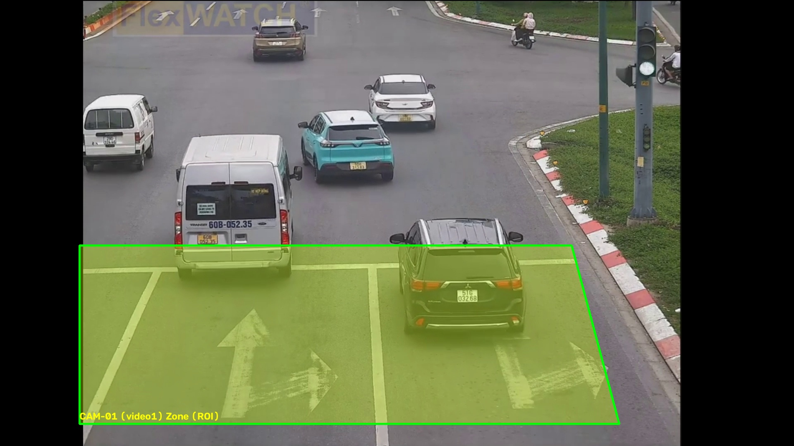

*Hình 3.1. Ảnh vùng quan tâm cấu hình cho CAM-01.*

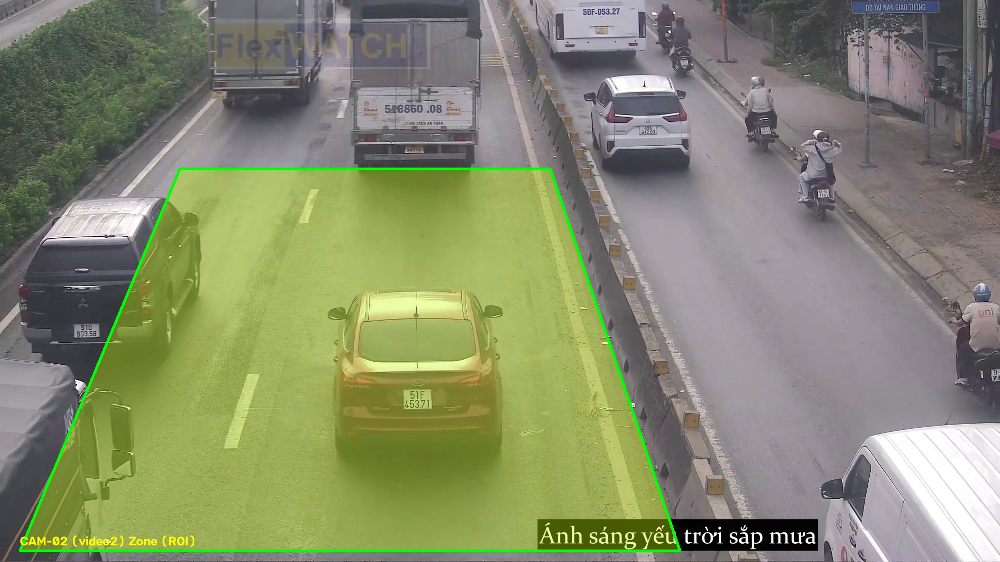

*Hình 3.2. Ảnh vùng quan tâm cấu hình cho CAM-02.*

### 3.2.4. Ước lượng chỉ số và phân loại trạng thái

Trong CameraWorker, mật độ tính từ số xe đang hoạt động trong ROI chia cho chiều dài đoạn quy ước theo km. PCU là tổng trọng số theo lớp. Tốc độ là trung bình các track đủ số lần quan sát; nếu thiếu quan sát, mã có giá trị dự phòng. Lưu lượng chủ yếu dùng mật độ nhân tốc độ và có thể trộn với lượt cắt vạch trong cửa sổ 30 giây. Các lựa chọn này tạo chỉ số hiển thị nhưng có thể lệch nếu track, thời gian video, tỷ lệ pixel/mét hoặc nguồn video không ổn định.

Phân loại trạng thái trong app.py và CameraWorker không hoàn toàn trùng nhau. Nhánh app.py tính nhiều chỉ số phụ trợ rồi dùng số xe, mật độ và tốc độ trong cây luật; CameraWorker sử dụng thêm ngưỡng free_thr, jam_thr và jam_speed riêng từng camera cùng bộ làm mượt trạng thái. Vì vậy kết quả giữa các nhánh có thể khác và cần thống nhất trước khi đánh giá.

Ngưỡng V/C, mật độ, tốc độ, chiếm dụng và PCU trong config.py là tham số ứng dụng. Chúng cần hiệu chỉnh, ghi rõ nguồn và kiểm định trên dữ liệu gán nhãn trước khi dùng để đưa ra kết luận giao thông chính thức. Trạng thái trong báo cáo được gọi là “nhãn heuristic của phần mềm”, không phải LOS chuẩn đã xác nhận.

## 3.3. Thiết kế cơ sở dữ liệu

Mô-đun backend/core/traffic_db.py tạo năm bảng:

| Bảng | Vai trò |
|---|---|
| users | Tên đăng nhập, password hash, role, thời điểm tạo, số lần đăng nhập sai và trạng thái khóa |
| analysis_sessions | Nguồn phân tích, camera, đường dẫn, thời điểm bắt đầu/kết thúc, số frame, FPS khai báo và trạng thái phiên |
| camera_metrics | Chỉ số gắn với camera/phiên: thời gian video, timestamp, chuỗi đếm theo lớp, PCU, mật độ, lưu lượng và tốc độ trung bình |
| audit_logs | Nhật ký sự kiện, chỉ số, trạng thái, khuyến nghị, người dùng và chi tiết |
| uploaded_videos | Tên tệp, đường dẫn, kích thước, thời lượng, độ phân giải, người tải và trạng thái |

Số lượng theo lớp được lưu dạng JSON trong count_by_class. camera_metrics liên kết session_id và video_time_sec, phân biệt các lần phân tích. Mô-đun mở SQLite với timeout và tạo index cho truy vấn thường dùng; không có cơ sở để mô tả WAL trong cấu hình hiện tại.

## 3.4. Thiết kế giao diện

Giao diện trang chính có bảy phân hệ:

1. **Tổng quan:** trạng thái tổng quát và thông tin nhanh từ camera.
2. **Giám sát trực tiếp:** stream MJPEG dạng lưới hoặc xem camera tập trung; trên ảnh có ROI, hộp phương tiện và HUD.
3. **Phân tích:** chọn camera và xem biểu đồ/chỉ số lịch sử có sẵn.
4. **Dự báo:** chọn nguồn, mô hình và khoảng dự báo; hiển thị phản hồi endpoint và chỉ số backtest khi có dữ liệu.
5. **Nguồn & Tải lên:** quản lý nguồn mẫu, video tải lên và gán video cho camera.
6. **Nhật ký:** lọc, xem và xuất nhật ký CSV.
7. **Cài đặt:** điều chỉnh nguồn, thông số camera và ROI theo chức năng backend.

Bố cục dùng HTML, CSS, JavaScript; biểu đồ dùng Chart.js. Tab Cài đặt không phải bảng điều khiển tín hiệu đèn; dự án không gửi lệnh tới hạ tầng giao thông.

## 3.5. Xây dựng hệ thống

### 3.5.1. CameraManager và CameraWorker

CameraManager khởi tạo sáu worker với các tệp cam3.mkv, cam4.mkv, cam5.mkv, cam6.mkv, cam7.mp4 và cam8.mp4. Tệp có thể được thay qua thao tác gán nguồn. Địa danh gắn với camera là văn bản cấu hình giao diện, không xác lập nơi quay video.

CameraWorker chạy vòng đọc/xử lý video trong luồng riêng, lưu frame JPEG mới nhất cho giao diện và cập nhật chỉ số. Stream lưới thu nhỏ về bề rộng 480 pixel và mã hóa JPEG chất lượng 55; stream chi tiết dùng chất lượng cao hơn. Mã có nhịp nghỉ xấp xỉ 0,038 giây mỗi vòng, nhưng điều đó không bảo đảm 25 FPS vì thời gian đọc, suy luận và mã hóa cũng cộng vào chu kỳ.

### 3.5.2. Chỉ số giao thông

Các chỉ số chính tại worker:

- Đếm đối tượng hiện diện trong ROI và đếm tích lũy theo track.
- Quy đổi PCU bằng trọng số theo lớp lấy từ cấu hình.
- Mật độ bằng số đối tượng chia cho chiều dài ROI quy đổi sang km.
- Tốc độ ước tính qua thay đổi tọa độ track và hệ số mét/pixel; làm mượt qua quan sát.
- Lưu lượng dùng Q = K × V, có thể kết hợp lưu lượng đếm qua vạch với trọng số 50/50 khi có sự kiện cắt vạch.
- Hàng chờ ước tính từ số track chậm dưới ngưỡng và quy đổi thành chiều dài giả định theo chiều dài trung bình phương tiện.

Các đại lượng trên mô tả logic phần mềm, chưa được xác nhận bằng thiết bị đo độc lập. Một số tham số như quy đổi pixel, chiều dài xe và ngưỡng tốc độ là giả định kỹ thuật.

### 3.5.3. Dự báo chuỗi thời gian

backend/core/forecaster.py cài đặt Holt damped trend với alpha 0,35; beta 0,15; phi 0,92 và moving average tối đa năm điểm. Khi có ít hơn ba quan sát hợp lệ, mô-đun trả trạng thái collecting. Backtest yêu cầu tối thiểu bốn mẫu, chia chuỗi xấp xỉ 70/30, tính MAE/RMSE/MAPE và bỏ mẫu actual bằng 0 khi tính MAPE.

Cần phân biệt mô-đun với endpoint /api/forecast: nếu lịch sử SQLite chưa đủ ba mẫu, route tạo năm điểm tạm bằng cách cộng nhiễu hình sin vào flow hiện tại của camera rồi mới gọi forecaster. Các điểm này không phải quan sát theo thời gian. Vì vậy kết quả fallback chưa phải dự báo hoàn toàn trên lịch sử thật; đây là điểm cần sửa trước khi đánh giá khoa học.

### 3.5.4. API và truyền dữ liệu

| Endpoint | Chức năng |
|---|---|
| /api/auth/login, /api/auth/logout, /api/auth/me | Xác thực và thông tin phiên |
| /api/cameras | Danh sách và trạng thái camera |
| /api/cameras/<id>/source | Gán nguồn video |
| /api/cameras/<id>/roi | Cập nhật ROI |
| /api/upload_video | Nhận và đăng ký video |
| /api/metrics | Truy vấn chỉ số/lịch sử |
| /api/forecast | Trả kết quả dự báo và backtest |
| /api/stream/<id> | Stream video MJPEG |
| /api/stream_events | SSE trạng thái camera |
| /api/logs, /api/logs/export | Truy vấn nhật ký và xuất CSV |
| /api/system_telemetry | Thông tin runtime/thiết bị phần mềm nhận biết |

Endpoint export hiện xuất nhật ký CSV; báo cáo không mô tả xuất Excel khi chưa thấy triển khai tương ứng.

\newpage

# CHƯƠNG 4: KẾT QUẢ VÀ THẢO LUẬN

## 4.1. Kết quả khảo sát dữ liệu và mô hình

### 4.1.1. Khảo sát bộ dữ liệu ảnh

Báo cáo EDA trong reports/eda/data_survey_report.md ghi nhận 12.000 ảnh, bốn lớp cân bằng. Mỗi lớp có 3.000 ảnh: 2.100 train, 450 validation và 450 test. Tổng số lần lượt là 8.400 train, 1.800 validation và 1.800 test. Ảnh có kích thước 640 × 640 pixel theo survey_summary.json.

| Lớp | Train | Validation | Test | Tổng |
|---|---:|---:|---:|---:|
| Xe máy | 2.100 | 450 | 450 | 3.000 |
| Ô tô con | 2.100 | 450 | 450 | 3.000 |
| Xe khách | 2.100 | 450 | 450 | 3.000 |
| Xe tải | 2.100 | 450 | 450 | 3.000 |
| **Tổng** | **8.400** | **1.800** | **1.800** | **12.000** |

Bộ dữ liệu cân bằng về số lượng lớp nhưng điều đó không đồng nghĩa dữ liệu đa dạng hoặc đại diện cho giao thông. Báo cáo EDA chưa mô tả đủ nguồn ảnh, quy trình gán nhãn, ảnh trùng giữa các tập, điều kiện ngày/đêm và cách tách theo video/địa điểm.

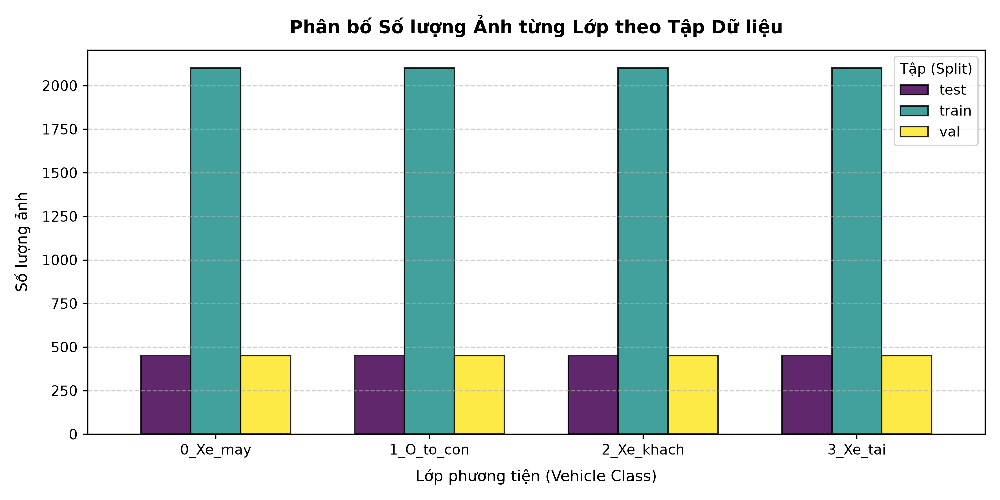

*Hình 4.1. Phân bố ảnh theo lớp và tập.*

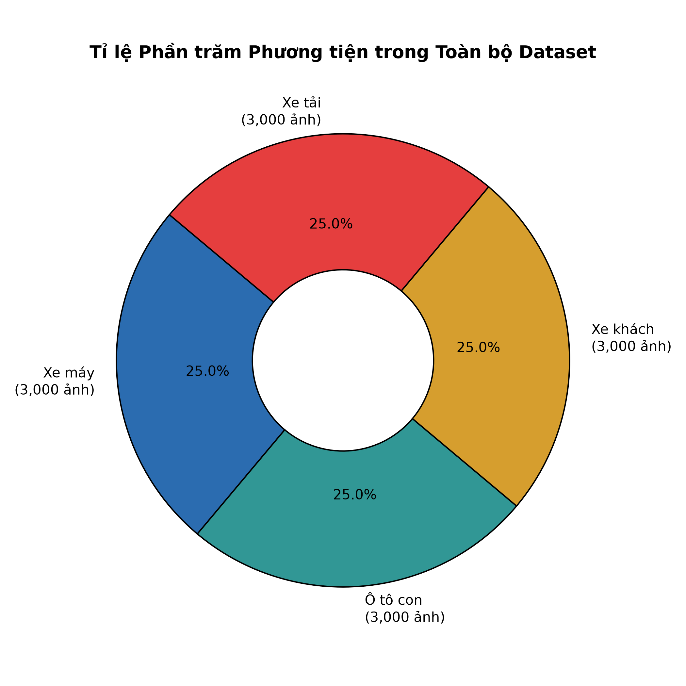

*Hình 4.2. Tỷ lệ bốn lớp trong bộ dữ liệu.*

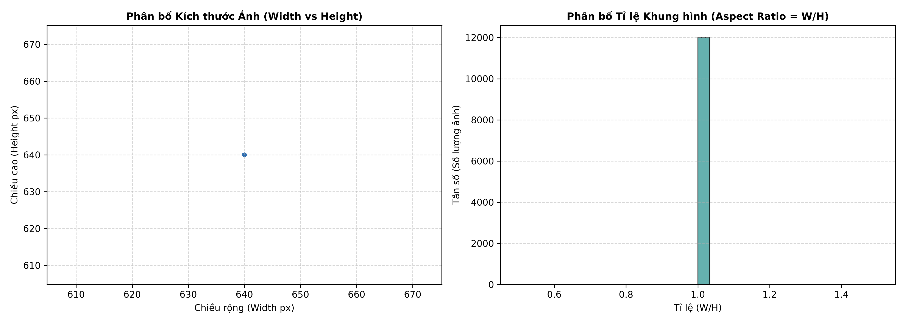

*Hình 4.3. Thống kê độ phân giải trong báo cáo EDA.*

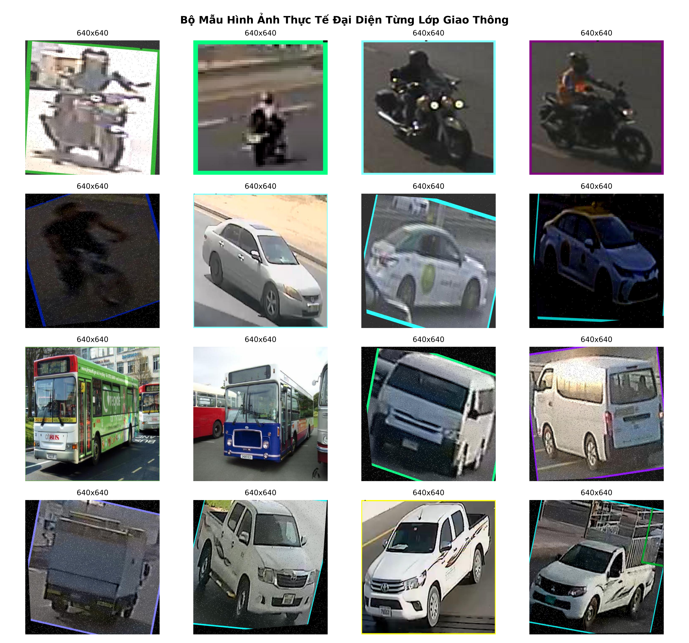

*Hình 4.4. Một số ảnh mẫu của bốn lớp phương tiện.*

### 4.1.2. Huấn luyện mô hình phân loại

args.yaml trong runs/classify/deep_train_results/yolov8s-cls_100ep ghi cấu hình yêu cầu 100 epoch, batch 32, imgsz 224, yolov8s-cls.pt, optimizer AdamW, learning rate ban đầu 0,001 và seed 0. Tuy nhiên, results.csv hiện có ghi epoch từ 1 đến 71; hàng cuối là epoch 71 với train loss 0,00751, Top-1 0,99595, Top-5 1,0 và validation loss 0,0306.

Vì vậy chỉ có thể kết luận cấu hình yêu cầu 100 epoch nhưng nhật ký lưu 71 epoch. Không khẳng định lần chạy đã hoàn tất 100 epoch hoặc hội tụ đến validation loss 0,0215. Cần xác minh phần log còn thiếu và dữ liệu trước khi mô tả đây là lần chạy hoàn chỉnh.

### 4.1.3. So sánh khảo sát 20 epoch

CSV trong reports/khao_sat_20ep ghi kết quả theo epoch cho YOLOv8s-cls và YOLOv8n-cls. Ở epoch 20:

| Chỉ số | YOLOv8s-cls | YOLOv8n-cls | Chênh lệch |
|---|---:|---:|---:|
| Train loss | 0,0425 | 0,0509 | s thấp hơn 0,0084 |
| Validation loss | 0,0303 | 0,0292 | n thấp hơn 0,0011 |
| Top-1 Accuracy | 99,31% | 98,46% | s cao hơn 0,85 điểm phần trăm |
| Precision | 99,06% | 98,65% | s cao hơn 0,41 điểm phần trăm |
| Recall | 99,23% | 98,39% | s cao hơn 0,84 điểm phần trăm |
| F1-score | 0,9915 | 0,9852 | s cao hơn 0,0063 |
| Top-5 Accuracy | 100% | 100% | Bằng nhau |

Theo CSV, YOLOv8s có Top-1, Precision, Recall và F1 cao hơn ở epoch 20; YOLOv8n có validation loss thấp hơn nhẹ. Đây là so sánh trên tệp hiện có, chưa đủ để kết luận mô hình tối ưu cho triển khai vì thiếu kiểm định lặp, thiết lập đo phần cứng và kết quả trên test set tách biệt.

Top-5 ít ý nghĩa trong bài toán chỉ có bốn lớp và không nên là chỉ số chính. Nên ưu tiên Top-1, ma trận nhầm lẫn, precision/recall theo lớp và kết quả test set. Bảng tóm tắt còn ghi latency/FPS, FLOPs, kích thước và mAP nhưng không kèm thiết bị, batch, warm-up hay quy trình benchmark. Các số này không được dùng làm kết luận định lượng; cột mAP cũng không được diễn giải như mAP phát hiện hộp trong thí nghiệm phân loại.

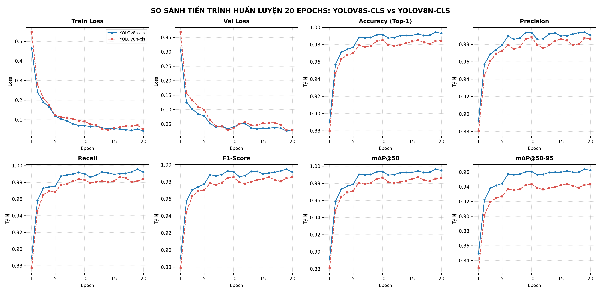

*Hình 4.5. Biểu đồ tổng hợp, cần đối chiếu với CSV nguồn.*

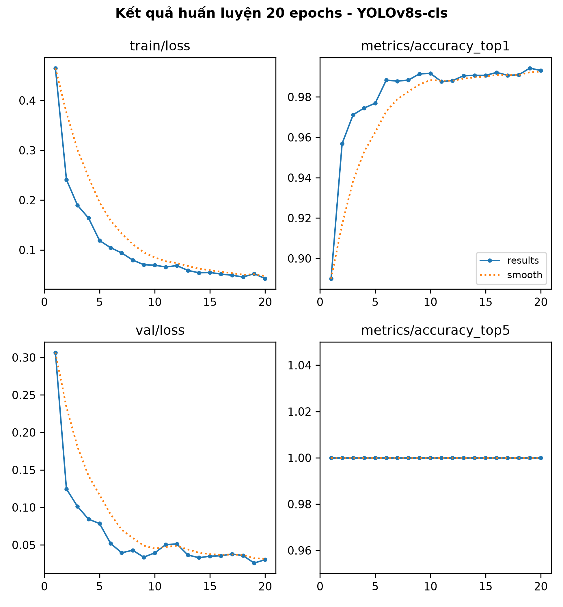

*Hình 4.6. Đường kết quả huấn luyện YOLOv8s-cls.*

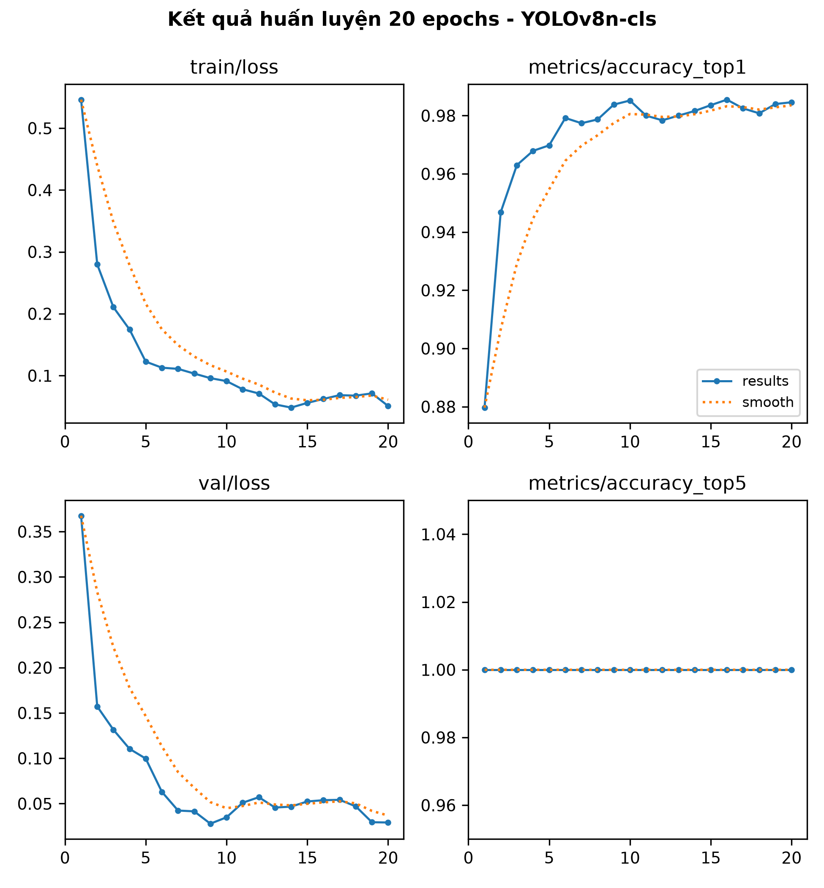

*Hình 4.7. Đường kết quả huấn luyện YOLOv8n-cls.*

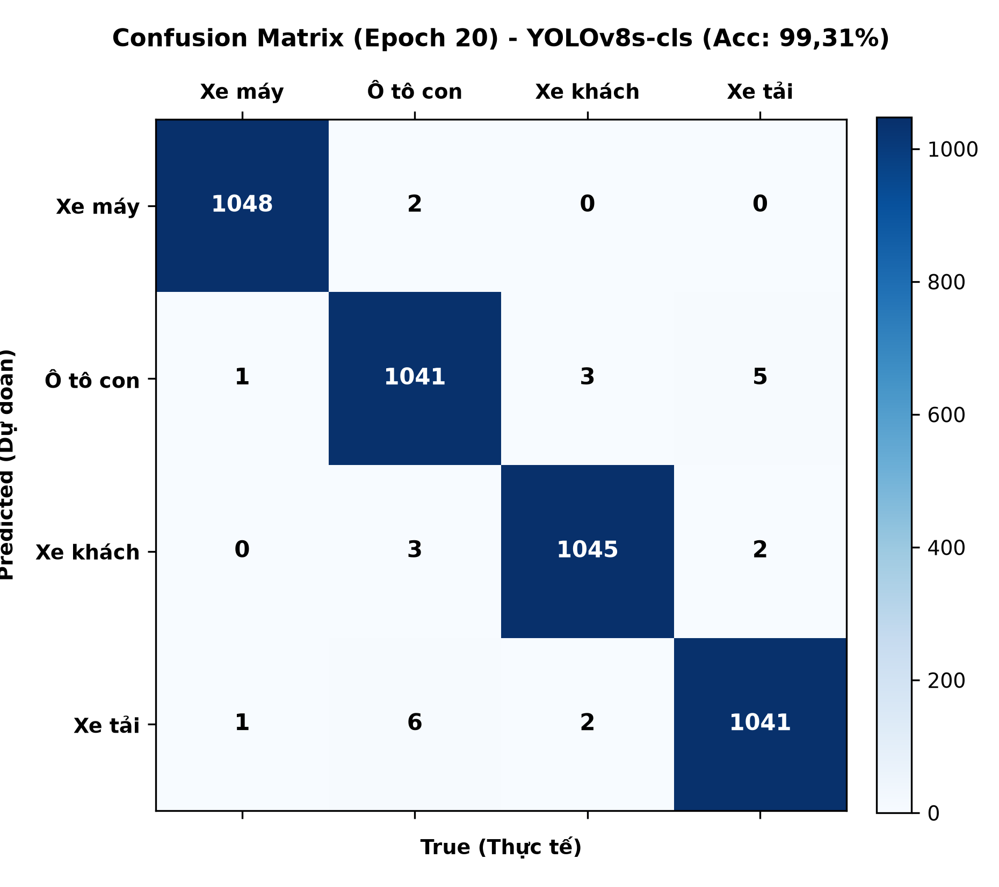

*Hình 4.8. Ma trận nhầm lẫn lưu cho YOLOv8s-cls; tổng mẫu trên ảnh cần đối chiếu trước khi trích dẫn.*

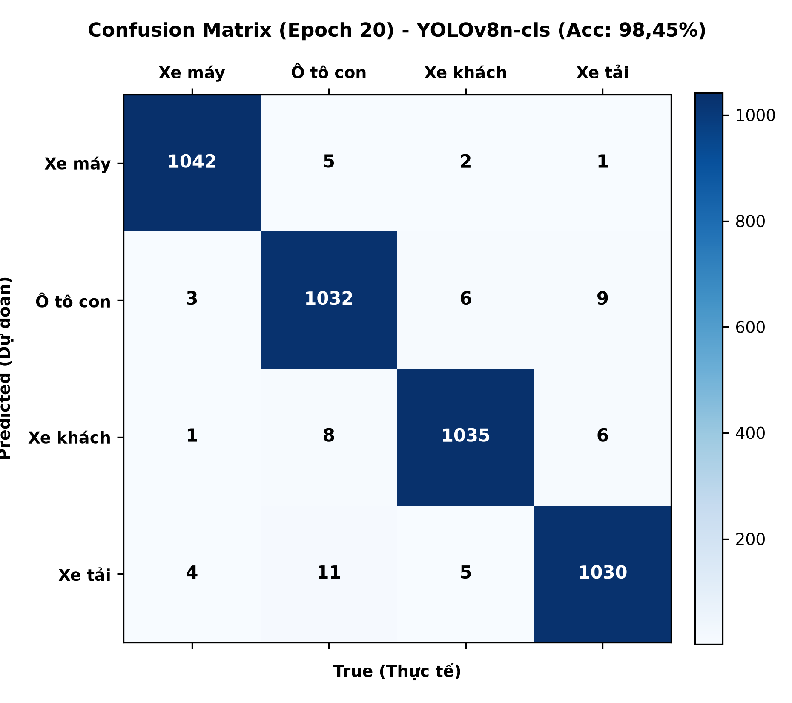

*Hình 4.9. Ma trận nhầm lẫn lưu cho YOLOv8n-cls.*

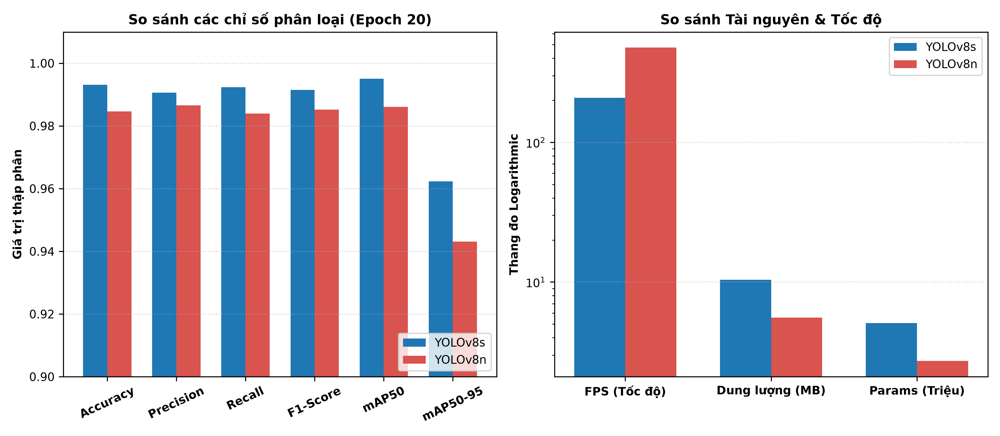

*Hình 4.10. Thông số benchmark trong biểu đồ chưa có biên bản phần cứng đi kèm.*

### 4.1.4. Ảnh mẫu và cấu hình ROI

reports/camera_zones có ảnh zone cho CAM-01 đến CAM-04 và một số frame mẫu. CameraManager trong mã nguồn cấu hình sáu worker; ảnh zone trong báo cáo mới bao quát bốn mã đầu. Ảnh là ví dụ theo cấu hình video, không phải biên bản khảo sát địa điểm thực.

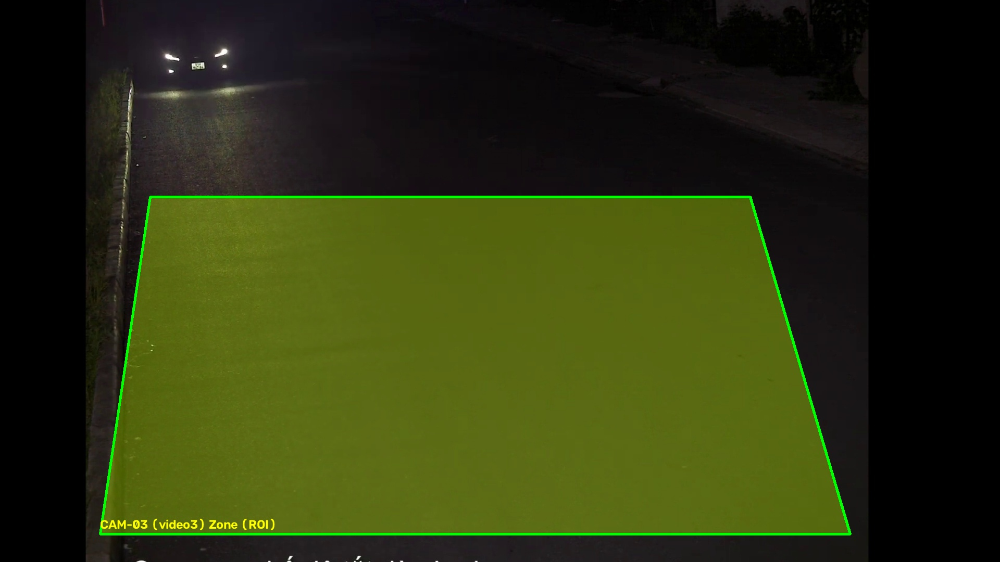

*Hình 4.11. Ảnh ví dụ vùng quan tâm CAM-03.*

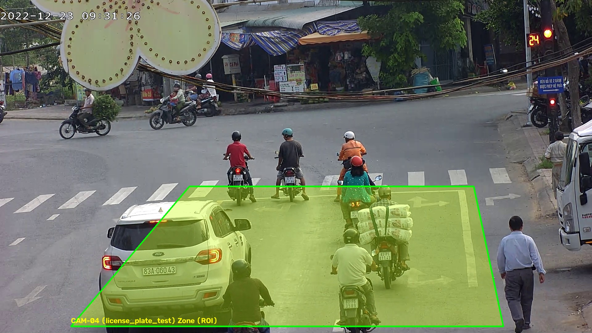

*Hình 4.12. Ảnh ví dụ vùng quan tâm CAM-04.*

## 4.2. Đánh giá phần mềm và giới hạn thực nghiệm

### 4.2.1. Chức năng quan sát được

Mã nguồn có ứng dụng Flask, giao diện bảy tab, sáu worker theo cấu hình, stream MJPEG, cập nhật SSE, quản lý nguồn video, tải tệp, cấu hình ROI, lưu phiên/chỉ số/nhật ký SQLite và endpoint dự báo. Khả năng chạy thực tế phụ thuộc môi trường thư viện, tệp video/trọng số và đường dẫn.

### 4.2.2. Độ chính xác nhận diện và đếm xe

Top-1/Precision/Recall/F1 phản ánh đánh giá phân loại theo CSV, không phản ánh sai số đếm xe trong video. Thư mục chưa có ground truth cho video, số đếm thủ công theo frame, đối sánh track hay phép tính sai số. Vì vậy không nêu sai số đếm 3,2% hoặc kết luận đếm trùng đã được loại bỏ hoàn toàn.

Để đánh giá đếm xe cần chọn video đại diện, lập số đếm chuẩn hoặc nhãn track, so sánh tổng số và số theo lớp, rồi công bố MAE/MAPE hoặc precision/recall sự kiện đếm cùng phân tích che khuất.

### 4.2.3. LOS, tốc độ và lưu lượng

Phần mềm có công thức, ngưỡng và nhãn trạng thái nhưng chưa có bộ đối chiếu độc lập. app.py và CameraWorker dùng luật/ngưỡng khác nhau. Tốc độ CameraWorker tính theo tỷ lệ pixel/mét xấp xỉ, còn mô-đun khác có helper homography. Lưu lượng có thể kết hợp Q = K × V với lượt cắt vạch. Do đó chỉ số hiện tại nên được diễn giải là ước lượng giao diện.

Cần thống nhất đơn vị xe hay PCU, cửa sổ thời gian, năng lực làn, hiệu chuẩn và bộ luật trạng thái; sau đó so sánh với điểm đo thực và đánh giá độc lập.

### 4.2.4. Hiệu năng và tài nguyên

Không có log benchmark đầu-cuối, cấu hình CPU/GPU, thời lượng ổn định, FPS đầu vào, độ trễ mạng hoặc bộ nhớ theo thời gian. Số latency/FPS của bảng tóm tắt mô hình không đủ suy ra tốc độ toàn ứng dụng sáu camera. Vì vậy không khẳng định stream đạt 28–30 FPS, độ trễ 70–90 ms hay vận hành liên tục nhiều tuần.

Benchmark phù hợp cần ghi phần cứng/phần mềm, chạy một rồi nhiều luồng với cùng cấu hình, đo FPS xử lý, FPS hiển thị, độ trễ đầu-cuối, CPU/RAM/VRAM và lỗi trong khoảng thời gian xác định.

## 4.3. Thảo luận

Bảng 20 epoch cho thấy YOLOv8s-cls đạt Top-1, Precision, Recall và F1 cao hơn YOLOv8n-cls; validation loss của YOLOv8n-cls thấp hơn nhẹ. Đây là quan sát trên tệp kết quả, không chứng minh ưu thế thống kê hoặc năng lực triển khai. Cần đánh giá trên test set độc lập và nhiều lần chạy.

EDA mô tả 1.800 ảnh validation và 1.800 ảnh test, trong khi báo cáo khảo sát ghi tập kiểm định 4.200 ảnh (1.050 ảnh/lớp). Con số này không trùng riêng với validation hoặc test. Cần xác định split đã dùng, bảo đảm không trộn validation/test rồi cập nhật mô tả.

Nhãn xe có độ tin cậy cao không đồng nghĩa lưu lượng chính xác; track liên tục không đồng nghĩa đếm đúng; nhãn heuristic LOS không phải đánh giá chuẩn nếu chưa hiệu chuẩn. Endpoint dự báo còn tạo dữ liệu tạm khi lịch sử thiếu. Nên bỏ fallback dạng nhiễu hình sin hoặc trả trạng thái collecting cho tới khi có đủ quan sát thật; nếu giữ chế độ demo thì phải đánh dấu đầu vào mô phỏng.

Để tăng giá trị khoa học, giai đoạn tiếp theo nên tập trung tái lập thực nghiệm, đánh giá định lượng, thống nhất thuật toán và kiểm soát chất lượng dữ liệu.

\newpage

# CHƯƠNG 5: KẾT LUẬN VÀ HƯỚNG PHÁT TRIỂN

## 5.1. Kết luận

Đồ án đã khảo sát và mô tả ứng dụng TrafficVision trong phạm vi mã nguồn và tài liệu có trong workspace. Ứng dụng gồm backend Flask, worker xử lý video, giao diện bảy tab, API cho camera/nguồn/ROI/dự báo/nhật ký, stream MJPEG và SSE, cùng SQLite với các bảng người dùng, phiên phân tích, chỉ số, nhật ký và video tải lên.

Bộ dữ liệu EDA ghi nhận 12.000 ảnh cân bằng trên bốn lớp, với 8.400 ảnh train, 1.800 validation và 1.800 test. CSV khảo sát 20 epoch ghi Top-1 Accuracy 99,31% cho YOLOv8s-cls và 98,46% cho YOLOv8n-cls; Precision, Recall và F1 ở epoch 20 cũng cao hơn ở YOLOv8s-cls. Những số liệu này cần gắn với đúng split và kiểm tra lại vì báo cáo khảo sát nêu quy mô kiểm định 4.200 ảnh, không khớp trực tiếp với validation/test trong EDA.

Tệp huấn luyện sâu đặt mục tiêu 100 epoch nhưng results.csv hiện lưu đến epoch 71. Vì vậy báo cáo không khẳng định lần chạy đã hoàn tất 100 epoch. Tương tự, chỉ số đếm xe, tốc độ, LOS và hiệu năng toàn ứng dụng chưa có phép đo độc lập đủ để xác nhận độ chính xác ngoài video mẫu.

Đóng góp trong phạm vi đồ án là tích hợp các thành phần xử lý video và giao diện thành ứng dụng có thể cấu hình nguồn, quan sát kết quả, lưu dữ liệu và khảo sát mô hình. PCU/ngưỡng trạng thái là tham số phần mềm; chức năng điều khiển tín hiệu đèn chưa triển khai.

## 5.2. Hạn chế

1. **Dữ liệu và khả năng tái lập:** Báo cáo EDA chưa xác nhận nguồn ảnh, quy trình gán nhãn, loại bỏ ảnh trùng và cách tách theo video/địa điểm. Đường dẫn trong cấu hình huấn luyện gắn với môi trường ổ đĩa cũ.
2. **Không thống nhất tập đánh giá:** EDA có validation và test 1.800 ảnh mỗi tập, còn báo cáo 20 epoch nêu 4.200 ảnh kiểm định. Cần truy nguyên tập dùng cho các chỉ số.
3. **Log huấn luyện chưa đủ 100 epoch:** Cấu hình ghi 100 epoch nhưng CSV hiện kết thúc ở epoch 71; nguyên nhân và trạng thái checkpoint cần xác minh.
4. **Tracking và đo tốc độ:** CameraWorker ghép tâm theo ngưỡng pixel; tốc độ xấp xỉ theo ROI. Che khuất, xe đi gần nhau, frame thay đổi hoặc sai hiệu chuẩn có thể làm lệch track và tốc độ.
5. **Chỉ số giao thông là ước lượng:** Công thức Q/K/V/PCU/V/C và ngưỡng trạng thái phụ thuộc cấu hình, có khác biệt giữa các nhánh mã; chưa được đối chiếu số liệu chuẩn.
6. **Dự báo chưa được kiểm định đủ:** Endpoint chèn dữ liệu mô phỏng khi lịch sử thiếu; backtest trên ít mẫu không chứng minh khả năng dự báo dài hạn.
7. **Hiệu năng toàn hệ thống chưa benchmark:** Chưa có báo cáo nhất quán về FPS, độ trễ, tài nguyên và thời lượng chạy đa camera; số benchmark trong bảng tóm tắt thiếu thông tin thiết bị.
8. **Đóng gói và triển khai:** Cần kiểm tra đường dẫn, trọng số, phụ thuộc và Docker; chưa có bằng chứng triển khai trên camera hiện trường hay thiết bị biên.
9. **Không có điều khiển đèn:** Giao diện không có phân hệ ra lệnh tín hiệu và backend chưa kết nối bộ điều khiển giao thông.

## 5.3. Hướng phát triển

1. **Chuẩn hóa dữ liệu:** Lập manifest gồm nguồn, nhãn, split, số lượng theo lớp và mã video/địa điểm; tách test độc lập để ngăn rò rỉ ảnh gần trùng.
2. **Tái lập huấn luyện:** Ghi lệnh chạy, phiên bản thư viện, phần cứng, seed, checkpoint và log; hoàn tất hoặc giải thích trạng thái 71/100 epoch.
3. **Đánh giá phân loại:** Báo cáo Top-1, ma trận nhầm lẫn và precision/recall/F1 từng lớp trên test set; không dùng Top-5 trong bài toán bốn nhãn làm kết quả chính.
4. **Đánh giá video:** Tạo tập video gán nhãn đối tượng và sự kiện cắt vạch; đo sai số đếm theo lớp, độ chính xác tracking, FPS và độ trễ đầu-cuối.
5. **Hiệu chuẩn hình học:** Đo điểm mốc trên mặt đường, lập homography từng camera và so sánh tốc độ video với phép đo tham chiếu.
6. **Thống nhất chỉ số giao thông:** Tập trung logic Q/K/V/PCU và trạng thái vào một mô-đun; cấu hình đơn vị/ngưỡng rõ ràng; phân biệt heuristic với phương pháp LOS đã kiểm định.
7. **Làm sạch dự báo:** Chỉ dùng quan sát thật để backtest; khi chưa đủ mẫu, trả collecting thay vì dựng chuỗi thay thế. Đánh giá theo nhiều cửa sổ và đường cơ sở.
8. **Cải thiện triển khai:** Kiểm tra Docker/import, chuyển đường dẫn tuyệt đối thành cấu hình tương đối, bổ sung tài liệu cài đặt và sao lưu cơ sở dữ liệu.
9. **Mở rộng có kiểm soát:** Sau khi kiểm định phép đo, có thể nghiên cứu nhận diện biển số, phát hiện sự kiện và kết nối nguồn camera. Điều khiển đèn cần nghiên cứu an toàn riêng, mô phỏng, giao thức được cho phép và cơ chế con người phê duyệt trước tác động vật lý.

\newpage

# TÀI LIỆU THAM KHẢO

1. **Bộ Giao thông Vận tải (2014),** *TCVN 10380:2014 - Đường giao thông nông thôn - Yêu cầu thiết kế*, Nhà xuất bản Xây dựng, Hà Nội.
2. **Transportation Research Board (2016),** *Highway Capacity Manual (HCM) 6th Edition: A Guide for Multimodal Mobility Analysis*, National Academies of Sciences, Engineering, and Medicine, Washington, D.C.
3. **Ultralytics LLC (2023),** *YOLOv8: Real-Time Object Detection and Image Segmentation*, [Online]. Available: https://github.com/ultralytics/ultralytics.
4. **Zhang, Y., Sun, P., Jiang, Y., Yu, D., Weng, F., Yuan, Z., Luo, P., Liu, W., & Wang, X. (2022),** "ByteTrack: Multi-Object Tracking by Associating Every Detection Box", *European Conference on Computer Vision (ECCV 2022)*, pp. 1-21.
5. **Bochkovskiy, A., Wang, C. Y., & Liao, H. Y. M. (2020),** "YOLOv4: Optimal Speed and Accuracy of Object Detection", *arXiv preprint arXiv:2004.10934*.
6. **Lighthill, M. J., & Whitham, G. B. (1955),** "On kinematic waves. II. A theory of traffic flow on long crowded roads", *Proceedings of the Royal Society of London. Series A*, 229(1178), pp. 317-345.
7. **Hartley, R., & Zisserman, A. (2004),** *Multiple View Geometry in Computer Vision (2nd Edition)*, Cambridge University Press.
8. **Hyndman, R. J., & Athanasopoulos, G. (2018),** *Forecasting: Principles and Practice (2nd ed)*, OTexts: Melbourne, Australia.
9. **Bradski, G. (2000),** "The OpenCV Library", *Dr. Dobb's Journal of Software Tools*.
10. **Paszke, A., Gross, S., Massa, F., Lerer, A., et al. (2019),** "PyTorch: An Imperative Style, High-Performance Deep Learning Library", *Advances in Neural Information Processing Systems (NeurIPS 2019)*, pp. 8024-8035.
